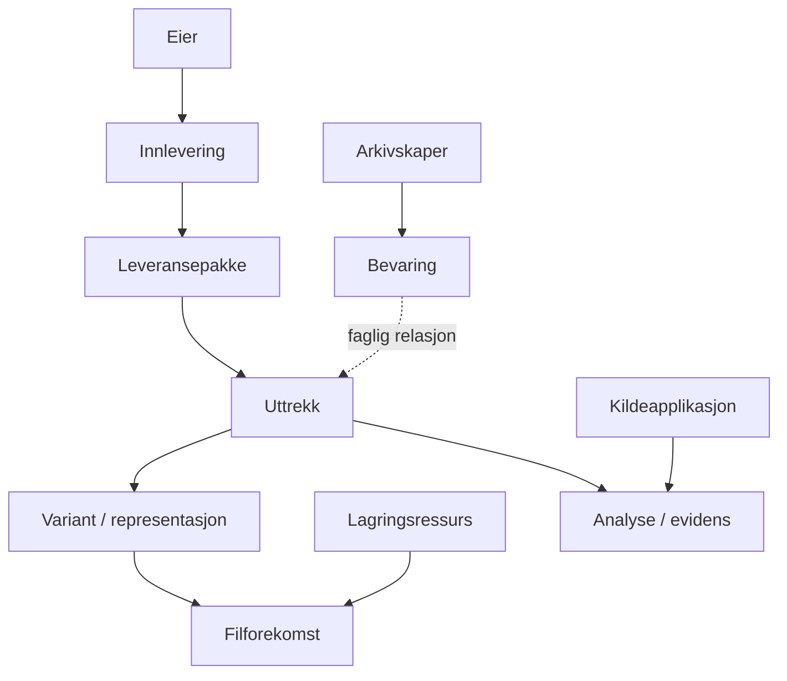

# Konseptuell datamodell

**Status: Arbeidsskisse, ikke vedtatt ER-modell.** Diagrammet viser mulige sammenhenger, ikke godkjente kardinaliteter eller tabellstruktur.

## Foreslåtte domener

- **A. Depotkatalog:** arkivskaper, eier, bevaring, system og historiske relasjoner.
- **B. Innleveringer:** mottak, leveransepakke, uttrekk og representasjoner.
- **C. Lagring:** lagringsressurs, volum, plassering, fil og fysisk forekomst.
- **D. Analyse:** valideringskjøring, teknisk evidens, resultat og vurdering.
- **E. Integrasjon:** eksterne identiteter, kildeapp, hendelse og synkronisering.

## Eksempler modellen må håndtere

1. Flere uttrekk fra ett mottak.
2. Flere mottak av samme bevaring, med test- og produksjonsvarianter.
3. Arkivskaper forskjellig fra dagens eierkommune.
4. Kryptert leveranse, TAR, DIAS SIP og utpakket arbeidsvariant.
5. Samme fil på flere disker uten at dette blir flere logiske uttrekk.
6. Generelle bilder/skannede filer på SAN uten kobling til bevaringsnummer.

Neste steg er å fastsette relasjoner, kardinaliteter, historikk og stabile identiteter gjennom Issues. Ikke opprett SQL-tabeller ennå.
